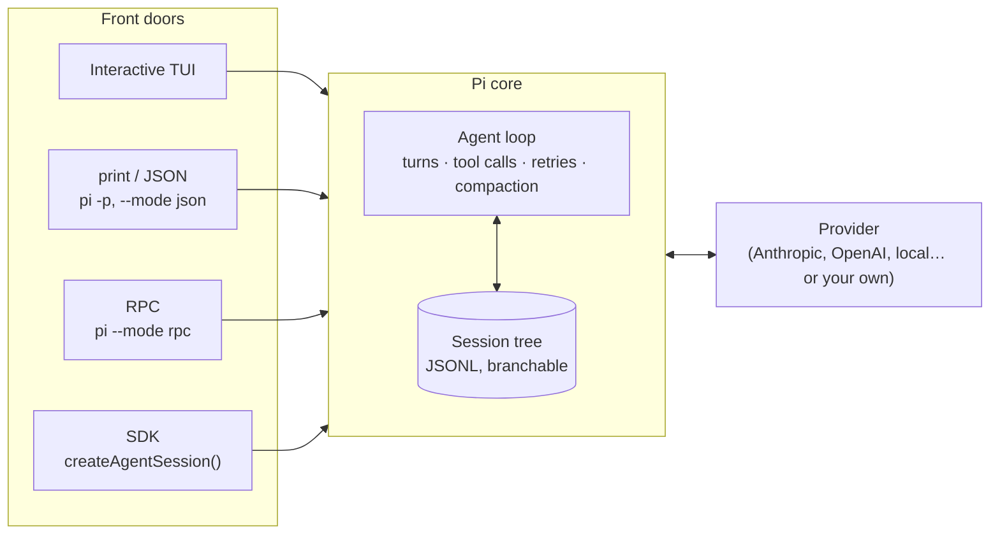
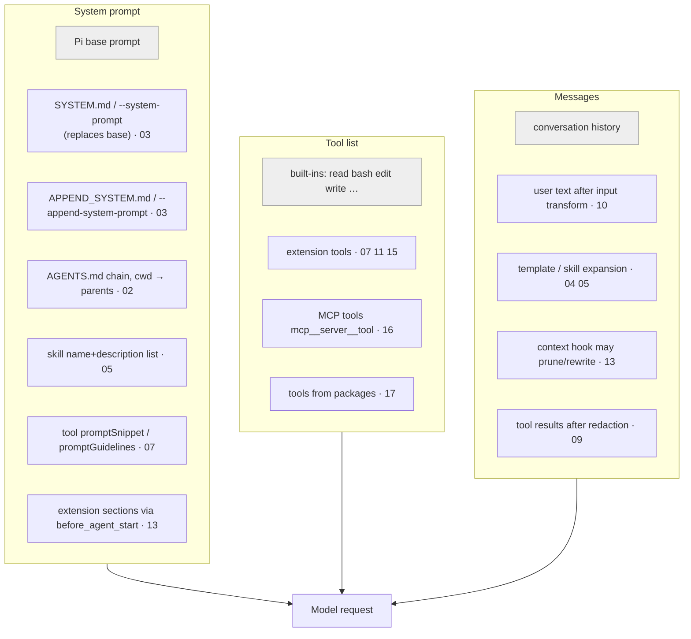

# How the pieces fit together

Pi is small on purpose: one **agent loop** plus a set of **plug-in points**. Every example in this repo is one plug-in point.
This page is the map. (Everything quoted here was captured from real runs of this repo; reproduce with `scripts/pi-stack`.)

## 1. One loop, five front doors



All front doors drive the **same** core, so an extension written once works in all of them (UI calls degrade gracefully — see
[12 · UI](../examples/12-ui/README.md)). The front door only decides *who is at the keyboard*: a human (TUI), a script
(print/JSON), another process (RPC) or your program (SDK).

## 2. What goes into ONE model request

A model request has three parts. Each plug-in point feeds one of them:



**Measured in this repo** (`inspect` with the mock model):

| Configuration | System prompt | Tools declared | Markers visible in prompt |
|---|---|---|---|
| `scripts/pi-iso` (nothing loaded) | ≈ 2.8k chars | 4 (`read bash edit write`) | — |
| `scripts/pi-stack` (everything) | ≈ 5.9k chars | 12 (+`roll_dice file_stats note unlock_admin_tools bundle_greet` + 3 MCP) | `root-agents-md`, `project-append-system`, `skill-changelog-writer`, `package-skill`, `tool-roll-dice`, `prompt-hooks-facts` |

Same agent, same code — the only difference is which plug-in points are populated. Note what is *not* in the prompt: skill **bodies**
(loaded on demand, via `read`) and tool **implementations** (the model only sees name/description/schema).

## 3. The life of a prompt (and where each example hooks in)

Real trace of `call roll_dice {"sides":20}` through the full stack (`.trace/events.log`, from [01 · trace](../examples/01-trace/README.md)):

```
input                  ← 10 input-transform may rewrite or swallow
before_agent_start     ← 13 prompt-hooks adds the project_facts section
agent_start
 turn_start            ─── TURN 1 ───────────────────────────────
 context               ← 13 prompt-hooks may prune history for this request
 before_provider_request  ← provider hooks (needs a provider that calls onPayload — see 00)
 message_end assistant ← model replies with a TOOL CALL
 tool_execution_start
 tool_call             ← 09 guardrails GATE: allow / ask / block / edit input
 tool_result           ← 09 guardrails: redact secrets   (skipped when the call was blocked!)
 tool_execution_end
 turn_end
 turn_start            ─── TURN 2: result goes back to the model ─
 …                     ← model writes the final answer
agent_end              ← one run done; retries / queued prompts may start another
agent_settled          ← Pi will NOT continue by itself: safe to treat as "finished"
```

Add one concept and the picture is complete: **extensions never talk to the model directly.** They sit in this pipeline, and the
model only ever sees what survives it.

## 4. Who decides? (the power ladder)

Start with the least powerful mechanism that works — it's also the safest.

| Mechanism | Code? | Model sees it? | Needs project trust | Typical use |
|---|---|---|---|---|
| `AGENTS.md` ([02](../examples/02-context-files/README.md)) | no | yes, always | no (still untrusted text) | project rules |
| `(APPEND_)SYSTEM.md` ([03](../examples/03-system-prompt/README.md)) | no | yes, always | yes | persona / house style |
| Prompt template ([04](../examples/04-prompt-templates/README.md)) | no | when *you* invoke it | yes | reuse a prompt |
| Skill ([05](../examples/05-skills/README.md)) | optional scripts | description always; body when relevant | yes | procedures with files |
| Theme ([06](../examples/06-themes/README.md)) | no | no | yes | colors |
| Extension ([07–15](../examples/07-custom-tool/README.md)) | **yes, in-process** | whatever it chooses | yes | tools, gates, UI, state |
| MCP server ([16](../examples/16-mcp/README.md)) | **yes, separate process** | its tools | yes | external systems |
| Package ([17](../examples/17-packages/README.md)) | **yes** | all of the above | yes | distribution |
| Provider ([00](../examples/00-mock-provider/README.md)) | **yes, sees every prompt** | n/a | yes | new model backends |

Extensions and providers run with **your OS permissions** and can read prompts, files, and credentials. Pi has no built-in sandbox and
asks no per-tool permission by default — [09 · guardrails](../examples/09-guardrails/README.md) shows how to add a gate, and
`docs/security.md` / `docs/containerization.md` (in the Pi package) cover real isolation.

## 5. Three interactions, end to end

### A) A blocked write travels through three extensions that don't know each other

`scripts/pi-stack -p 'write .env SECRET=1'`

```
mock model ── toolCall write(.env) ─▶ 09 guardrails.tool_call  → { block: true }
                                       │  pi.events.emit("guardrails:blocked", …)
                                       ├──────────────▶ 14 audit-log.ts       appends to .trace/audit.jsonl
                                       └──────────────▶ 14 blocked-counter.ts footer shows "🛡 1 blocked"
01 trace sees:  tool_call → tool_execution_end   (no tool_result!)
model gets:     isError result "Path \".env\" is protected"  → explains it to the user
```
Why the gate emits the event itself: blocked calls skip `tool_result`, so a listener there would never hear about them.

### B) The same action, three front doors

`run rm -rf …` triggers the guardrail's confirmation:

| Front door | What happens | Try |
|---|---|---|
| TUI | Yes/No dialog | `scripts/pi-stack`, type `run rm -rf /tmp/zz` |
| RPC | `extension_ui_request` → your client answers | `node examples/19-rpc/rpc-raw.mjs [deny]` |
| print / JSON | no UI → **fail closed**, blocked | `scripts/pi-stack -p 'run rm -rf /tmp/zz'` |

One extension, three behaviours, chosen by `ctx.hasUI`. This is why extension logic must not assume a terminal.

### C) State and time travel

`note` ([11](../examples/11-stateful-tool/README.md)) stores its list in tool-result `details`, so the session tree *is* the database.
`/tree` to an earlier point and `/notes` shows the earlier list; `--continue` restores it after a restart; an RPC `fork()` before the
second note gives a session whose list is just the first (verified in this repo). Compare a global variable: it would stay wrong after rewinding.

## 6. Ordering and precedence — the rules that explain surprises

| Rule | Consequence |
|---|---|
| Extensions load in settings/`-e` order; **handlers run in that order** | put observers ([01](../examples/01-trace/README.md)) first to see input others swallow |
| Transforms chain; gates short-circuit | `input`/`tool_result`/`context` pass results along; `handled`/`block` stop the chain |
| Project settings override user settings; resource lists (extensions, skills, …) **combine** | a project *adds to* your user-level lists rather than replacing them; use `-ns`/`-ne` or `!pattern` filters to cut |
| Extension command > prompt template of the same name | `/review` as an extension command hides a `/review` template |
| Context files: every `AGENTS.md` from cwd up to root, **additive** | `examples/02-context-files/nested` sees its parent *and* the repo root |
| `SYSTEM.md` replaces only the *base* prompt | context files, skills, sections still append (verified) |
| A blocked tool call skips `tool_result` | audit from the gate, not from `tool_result` |
| `agent_end` ≠ idle | wait for `agent_settled` (RPC/SDK clients especially) |
| Project resources need trust; user-level ones don't | `-a` / `-na` / `/trust` / `defaultProjectTrust` |
| Hooks on provider calls only fire if the **provider** calls the callbacks | custom providers must call `onPayload`/`onResponse` |

## 7. Choosing between look-alikes

| You want… | Use… | Not… |
|---|---|---|
| model always knows a rule | `AGENTS.md` | a skill (might not be loaded) |
| model learns a procedure only when relevant | skill | `AGENTS.md` (always costs tokens) |
| *you* trigger a canned prompt | template | skill |
| the model gets a new ability | tool (extension) | a skill that tells it to run `curl` |
| a third-party system's tools | MCP | re-implementing it as extension tools |
| stop/alter dangerous actions | `tool_call` gate | prompt instructions ("please don't…") |
| shrink what the model sees | `context` hook / compaction | deleting session history |
| extensions cooperate | `pi.events` | importing each other |
| call Pi from another language | RPC | scraping the TUI |
| call Pi from Node | SDK | spawning `pi -p` repeatedly |

Next: [Cheat-sheet →](03-cheatsheet.md) · or learn by doing: [Walkthroughs →](04-walkthroughs.md)
